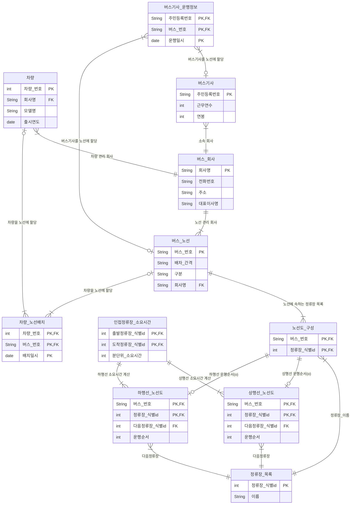

## 문제1의 DB
- 자격증의 취득일시를 추가하였습니다.
- 취업신청내역의 신청일시와 취업확정내역의 취업확정일시를 추가하였습니다.
- 구직자에 이름, 전화번호를 추가하였습니다.
- 대학교의 취업자 수는 취업확정내역이 업데이트될때 Trigger를 사용해서 자동으로 업데이트합니다.
- 기업의 희망 구직자 수는 취업신청내역 업데이트시 Trigger를 사용해서 자동으로 업데이트합니다.

```mermaid
erDiagram
  기업 {
    String 회사명 PK
    String 산업분야
    int 희망_구직자_수 
    String 신청_기간
    int 초봉
  }
  구직자 {
    String 주민등록번호 PK
    String 이름
    String 전화번호
    String 대학명 FK
    String 전공_분야
    decimal(3,2) 대학_학점
    int 토익_성적
    int 희망_연봉
  }
  자격증_취득내역 {
    String 주민등록번호 PK, FK
    String 자격증_이름 PK
    date 취득일시
  }
  구직자_취업신청내역 {
    int 신청번호 PK
    String 주민등록번호 FK
    String 회사명 FK
    date 신청일시
  }
  취업확정 {
    int 신청번호 PK, FK
    date 취업확정일시
  }
  대학교 {
    String 대학명 PK
    String 주소
    String 대학설명
    int 취업자_수  
  }

  구직자 ||--o{ 구직자_취업신청내역 : "취업신청내역"
  기업 ||--o{ 구직자_취업신청내역 : "취업신청내역"
  자격증_취득내역 o{--|| 구직자 : "자격증 취득"
  구직자 o{--o| 대학교 : "출신대학"
  구직자_취업신청내역 ||--o| 취업확정 : "특수화"
  
```


## 문제2의 DB
- 같은 노선의 상행, 하행선이 존재한다고 가정하였습니다.
- 상행선, 하행선의 운행순서는 다르지만 정류장 구성은 같다고 가정하였습니다.
- 달서-3, 급행 5 같은 사례들을 고려하여 버스번호는 문자열로 하였습니다.
- 정류장 A->B, B->A 운행할 때 방향에 따라 소요시간이 다를 수 있다고 가정하였습니다.
- 그날 노선에 배치된 버스는 상행, 하행을 왕복하며 운행한다고 가정하였습니다.
- 버스기사, 차량, 노선은 신규 등록 당시를 대비해서 운행정보가 없을 수도 있다고 가정하였습니다.




